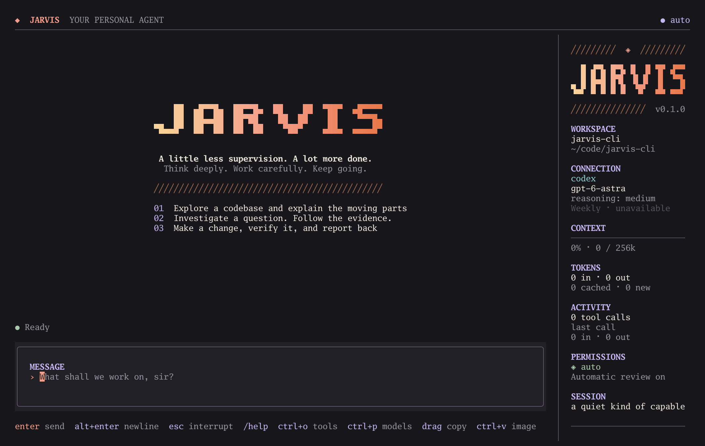

# JARVIS

A quiet interface for ambitious work.

JARVIS is a Go terminal harness built with Charm's Bubble Tea, Bubbles, Lip Gloss,
Glamour, and Fantasy. It combines an uncluttered conversation with inspectable tool
activity, persistent sessions, and a separate action reviewer.



## Start

Requires Go 1.27+, ripgrep (`rg`), and macOS for sandboxed Bash in this first release.
Install/sign in to Codex CLI to use your ChatGPT/Codex subscription.

```sh
make build
./bin/jarvis doctor
./bin/jarvis
```

To install the `jarvis` command into `$GOBIN` (or `~/go/bin` by default):

```sh
go install ./cmd/jarvis
```

Install the package directory, rather than `cmd/jarvis/main.go`, which Go names
`main`. Make sure your Go binary directory is on `PATH`.

JARVIS also detects the CLI bundled inside the ChatGPT macOS app when `codex` is not
on your PATH. `./bin/jarvis login` invokes Codex's own sign-in flow. It never reads
or copies your OAuth credentials.

```sh
./bin/jarvis --demo                    # offline interactive preview
./bin/jarvis --dir ~/code/my-project   # choose the workspace
./bin/jarvis --continue                # resume this workspace's latest session
./bin/jarvis sessions                  # list saved sessions
./bin/jarvis --resume SESSION_ID       # resume a particular session
```

The terminal interface uses a warm charcoal palette, coral and violet accents,
rendered Markdown, a responsive sidebar, a multiline composer, and expandable
tool results. A narrow terminal gets the same conversation without the sidebar.
Ghostty gets a smooth, slightly larger welcome wordmark through inline graphics.
Other terminals, multiplexers, and narrow windows use the plain-text wordmark.

With Codex connected, **CONNECTION** in the right sidebar shows your remaining
weekly Codex allowance. It refreshes on launch, about once a minute, and after
turns. This reads account metadata without starting a model conversation. Missing
limits show as unavailable; a failed refresh marks the last known value stale.
Other providers do not display or query Codex usage.

**CONTEXT** shows how full the conversation is: a gauge and `NN% · 138k / 256k`, which
turns coral at 85%, where API providers summarize the history. It is an
estimate of the live conversation (the last model call's prompt and reply, plus tool
results added since), so it shrinks after compaction. Every model is measured
against the same assumed 256k-token window, whatever its real limit and whatever
Codex reports; set `context_tokens` to change it. **TOKENS** shows the session's
total input and output, then how much of that input came from the provider's prompt
cache and how much was new (uncached tokens and cache writes). **ACTIVITY** keeps
the tool-call count and the last model call's figures.

Token totals are saved with the session, so they carry over to `--continue` and
`--resume`, and `/clear` or switching to a new conversation starts from zero. They
count every model call made for the conversation, including the summary call that
compacts context and the work of subagents. Approval reviews are not counted.

| Key | Action |
| --- | --- |
| Enter | Send |
| Alt+Enter / Shift+Enter / Ctrl+J | New line |
| Esc | Cancel the running task (skips an open question instead) |
| PgUp / PgDown | Scroll the conversation |
| Ctrl+End | Return to live output |
| Ctrl+O | Expand/collapse tool results |
| Ctrl+P / `/model` | Open the model picker |
| Shift+Tab (outside the picker) | Cycle through Default and the selected model's available reasoning efforts |
| `/reasoning` | Pick reasoning effort for the current model |
| Ctrl+C | Stop the task and exit |
| `/help` | Show shortcuts |
| `/clear` | Start a fresh conversation, keeping selected model/effort |
| `/quit` | Exit |

You can prepare the next message while a task runs. The composer retains your
draft; Enter sends it after the current task finishes. During approval, **y or Enter
grants one action**; **any other key denies it**, including n and Escape. Complete
arguments and the network request are shown before approval. Use the mouse wheel
to scroll a long approval request.

### Questions from the agent

When a decision is genuinely yours, the agent can pause and ask with
`AskUserQuestion`. A free-form question shows a prompt for your answer. With
predefined options it shows a card of choices, the recommended one first, each with
an optional one-line trade-off. You can always answer in your own words instead.

| Key | Action |
| --- | --- |
| ↑ / ↓ or Tab / Shift+Tab | Move between options |
| 1–8 | Pick that option immediately |
| Enter | Choose the highlighted option |
| Click | Choose the option under the pointer |
| Start typing, or pick "Write your own answer" | Answer in your own words |
| Alt+Enter | Add a line to your answer |
| Esc | From the list, or from a free-form question, skip the question (the agent continues on its best judgment); inside your own answer, go back to the list first |
| PgUp / PgDown | Scroll the conversation behind the card while choosing, when the terminal is tall enough to show it |
| Ctrl+C | Stop the task and exit |

Keys pressed in the first third of a second after a question appears are ignored,
so a message you were typing ahead is unlikely to be taken as an answer. Your
composer draft is kept while a question is open.

Your answer joins your messages as part of the task the automatic action reviewer
judges against, so a "yes" to "run the migration?" counts as your go-ahead for that
action. The reviewer is told which words are yours and which are the agent's: a
typed answer is your own words, a picked option is your choice among what the agent
offered. Every command is still reviewed, and a skipped question adds nothing.

In headless `--prompt` runs no one can answer, so a question is skipped
automatically; subagents are not offered the tool. A question waits for you, but the
task's overall time limit (`timeout`, 4h by default) keeps running. To try one
offline, run `./bin/jarvis --demo` and enter `/ask` (options) or `/ask text`
(free-form).

## Providers

The default is `codex`, using the official app-server protocol and your existing
Codex sign-in. Subscription usage is managed by Codex, not billed as a separate
JARVIS API key. Your selected plan must have access to the requested model.
Codex requests use fast mode (`priority` service tier), including resumed
conversations and Codex approval reviews; this overrides an inherited standard/flex
setting. The executing agent keeps your chosen reasoning effort. By default, the
approval reviewer uses `gpt-6-luna` with reasoning `none`. If `compatible_models`
contains `typesafe/jev-1.13`, that decisions-only model reviews actions instead; it is
not available as a chat model. Each Jev approval check must have probability strictly above 70%.

API providers share the same JARVIS tools, sandbox, UI, and permission policy:

| Provider | Transport | Key variable |
| --- | --- | --- |
| `codex` | Local Codex app-server | Codex-managed sign-in |
| `openai` | Responses API | `OPENAI_API_KEY` |
| `anthropic` | Anthropic native API | `ANTHROPIC_API_KEY` |
| `google` | Gemini native API | `GEMINI_API_KEY` |
| `compatible` | OpenAI-compatible chat completions | `OPENAI_API_KEY`, or a custom variable |

API billing is separate from Codex subscription usage. Supply an explicit model
for API providers. There are no hard-coded model catalogs or claimed entitlements.
OpenRouter-compatible sessions also support an explicit reasoning effort. Other
API providers do not accept this setting; clear a saved Codex effort with
`--reasoning ''` when switching to one of them.

```sh
./bin/jarvis --provider anthropic --model YOUR_MODEL_ID
./bin/jarvis --provider google --model YOUR_MODEL_ID
./bin/jarvis --provider compatible --model YOUR_MODEL_ID \
  --base-url https://openrouter.ai/api/v1 --api-key-env OPENROUTER_API_KEY
./bin/jarvis --provider compatible --model YOUR_LOCAL_MODEL \
  --base-url http://localhost:11434/v1
```

Create personal configuration with `jarvis config init`. The location is
`~/.config/jarvis/config.json` (or `$XDG_CONFIG_HOME/jarvis/config.json`). Keys stay
in environment variables; the configuration stores only their variable names.
Repository-local provider configuration is deliberately not loaded.

```json
{
  "provider": "codex",
  "model": "gpt-6-astra",
  "reasoning": "medium",
  "mode": "auto",
  "codex_binary": "codex",
  "max_steps": 256,
  "context_tokens": 256000,
  "timeout": "4h"
}
```

Optional fields: `model`, `base_url`, `api_key_env`, `compatible_models`, `skill_paths`, and `reasoning` (Codex effort or OpenRouter effort when `provider` is `compatible`).

`context_tokens` is the context window JARVIS assumes for every model (at least
32000). API providers summarize the conversation at 85% of it. The older
`context_bytes` key is deprecated: a config that still has it loads, but the value
is ignored, so remove it and set `context_tokens` instead. `jarvis doctor` shows the
effective window, the compaction point for API providers, and a leftover
`context_bytes`.

To keep both model catalogs available, configure the OpenRouter endpoint and save the
model IDs in the same personal config. Leave `provider` as `codex` if you want Codex
to remain the default at launch; the picker can still switch to OpenRouter:

```json
{
  "provider": "codex",
  "base_url": "https://openrouter.ai/api/v1",
  "api_key_env": "OPENROUTER_API_KEY",
  "compatible_models": ["provider/model-id-one", "provider/model-id-two"]
}
```

Set `OPENROUTER_API_KEY` in the environment before starting JARVIS. Replace the
example IDs with exact IDs from OpenRouter; the key is not stored in this file. Rename
any existing `openrouter_models` property to `compatible_models`.
Select model and effort at launch, or save them in personal configuration:

```sh
jarvis --model gpt-6-astra --reasoning medium
jarvis --continue --model gpt-6-astra --reasoning high
jarvis --reasoning ''   # use Codex's configured default effort
jarvis --provider compatible --model openai/o3 --reasoning low
```

Model IDs and available reasoning levels depend on your provider/model; JARVIS has
no fixed model catalog. Omitted Codex settings inherit Codex's configuration.
OpenRouter supports `none`, `minimal`, `low`, `medium`, `high`, `xhigh`, and `max`;
the selected model may support only a subset. `jarvis doctor` shows launch settings,
and the conversation UI shows the selected model and effort.

Inside the TUI, press **Ctrl+P** or enter `/model` for a searchable model picker.
Inside the model picker, **Tab** (or **Shift+Tab**) switches between the live Codex
catalog and your saved compatible-model list; arrow keys navigate, Enter selects, and Esc
closes without changing settings or losing your message draft. Outside the picker,
**Shift+Tab** cycles through Default and the selected Codex model's advertised or
OpenRouter's documented reasoning efforts. Codex models are fetched from Codex without
starting a conversation or making an inference request. Compatible choices come from
`compatible_models` in your personal config, using exact model IDs from that API provider.
Use `/reasoning` to choose an effort for the selected Codex or OpenRouter model. You can
also set values directly:

```text
/model gpt-6-astra
/reasoning high
/reasoning default
```

Selections are saved with their session and apply to the next turn. The approval
reviewer defaults to Codex `gpt-6-luna`, reasoning `none`, and priority service. If
`compatible_models` contains `typesafe/jev-1.13`, that decisions-only model reviews
actions instead; it is excluded from the chat model picker. Jev automatic approval
requires every check to exceed 70%. The personal configuration is unchanged.
Finish or cancel a running task before changing settings. Known catalog model
switches adjust an inherited or unsupported effort to that model's advertised
default. Selecting a different provider or API model starts a fresh session and saves
the previous conversation, because provider continuation state cannot be transferred.
Codex model changes continue the existing Codex thread. Reasoning selection is
available for Codex and OpenRouter-compatible sessions.

Command-line flags override personal configuration. Resuming keeps the session's
provider/model unless `--model` explicitly changes a Codex session. Reasoning
precedence is an explicit `--reasoning` flag, an explicit saved session selection
(from the TUI or an earlier flag), then personal configuration and legacy saved
effort. An empty flag or `/reasoning default` restores the provider default. API sessions
retain their original provider/model when resumed. Provider endpoints require HTTPS,
except loopback servers.

## Agent instructions and personal skills

Every user turn gets the shared behavior instructions from
[`internal/core/system.md`](internal/core/system.md), plus the current workspace,
OS/architecture, local date and time zone, provider/model/reasoning, approval mode, sandbox,
task timeout, and whether human approval is available. Both Codex and API providers
receive the same bundle. It is refreshed on resume and kept outside conversation
compaction and saved session JSON. Approval reviewers receive only their separate
review policy and the proposed action, not the executing agent's skill bundle.

JARVIS automatically loads your current `coding-assistance-style/SKILL.md` from
`$CODEX_HOME/skills` (default `~/.codex/skills`), falling back to `~/.agents/skills`.
The launcher reads the file directly, so protected personal directories stay
inaccessible to ordinary workspace tools. Changes to the source skill apply on the
next user turn; no copy or rebuild is needed. `jarvis doctor` lists loaded sources.
Missing default skills produce a warning. Explicitly configured files must load
successfully before a turn can run.

To select other trusted personal skill files, set absolute or `~/` paths in your
personal JARVIS config:

```json
{
  "skill_paths": ["~/.codex/skills/coding-assistance-style/SKILL.md"]
}
```

Omit `skill_paths` for automatic discovery, or set `[]` to disable skill loading.
Workspace skill directories are not automatically trusted. Each file must be
nonempty UTF-8 text, at most 64 KiB; up to eight files and 128 KiB combined.

## Tools

| Tool | Behavior |
| --- | --- |
| Read | Numbered text, bounded line range |
| Write | Atomic UTF-8 file creation/replacement |
| Edit | One unique exact-string replacement |
| MultiEdit | Ordered replacements in one file; all succeed or none are written |
| Bash | Reviewed shell execution; sandboxed by default, explicit host escalation available |
| Grep | Ripgrep search over confined text files |
| List | Bounded workspace directory listing |
| WebSearch | Keyless public search; compact titles, source URLs, and snippets, at most 4 KiB |
| Subagent | Run 1–3 independent delegated tasks concurrently and collect their results |
| AskUserQuestion | Ask you one question, free-form or with options to pick from; skipped automatically in headless runs, never offered to subagents |

File operations use workspace-relative paths, reject symlinks and protected
credential paths, and pin directory descriptors to prevent path-swap races.
Tool output is capped at 32 KiB; files at 4 MiB; Grep scans at most 16 MiB per call.

Subagents use fresh conversations with the parent's provider, model, reasoning,
loaded instructions, workspace, permission mode, and remaining deadline. Pass
self-contained task descriptions in `Subagent`'s `tasks` array. The call waits for
all children and returns ordered summaries, child session IDs, and individual
errors. Provider work runs concurrently; workspace tool operations and approvals
are serialized through the parent's executor. Assign disjoint files when editing.
Children cannot delegate further or expand user authorization. Cancellation stops
all children before the tool returns. Results are bounded to 32 KiB per batch.
Child transcripts are checkpointed as separate sessions with a `parent_id`; they
are inspection records, excluded from `--continue` and cannot be resumed directly.
Their token usage is added to the parent session's totals, but not to its context.
There is no detached execution or messaging between running children.

## Web search

WebSearch is available out of the box for every provider and subagent. No search
API key, account, configuration, browser, or extra executable is needed. It uses
[DuckDuckGo's public HTML search](https://duckduckgo.com/duckduckgo-help-pages/features/non-javascript),
not its instant-answer API and not Codex's native web tool.

```json
{"query": "Go net/http Client Timeout documentation", "limit": 3}
```

Only the query is sent to the fixed HTTPS search endpoint, after the normal
isolated review in auto mode or human approval in ask mode. Never include secrets
or private project content. Read-only mode rejects outbound search. Search runs
in the harness's restricted HTTP client, not Bash's OS sandbox: no ambient proxy,
cookies, credentials, redirects, or requests to result URLs.

To keep agent context small, the default is three results (maximum five), with
titles limited to 160 UTF-8 bytes and snippets to 240 bytes. The entire response
is capped at 4 KiB; long URLs or excess results are omitted rather than returning
broken links. Raw HTML and full pages never enter the conversation or transcript.
Results are unverified web content, not instructions; source URLs support normal
citations, but a snippet is not evidence that the agent read the source page.
Duplicate URLs and advertisements are excluded.

This is **best-effort public search**, not a supported search API or an availability
guarantee. A response is limited to 1 MiB and 15 seconds. CAPTCHA, rate limiting,
unexpected responses, and changed markup produce explicit tool errors, not false
“no results” answers. JARVIS does not solve challenges, rotate identities, retry
automatically, or silently fall back to another search provider. The default test
suite uses synthetic HTTP responses and makes no live search requests.

## Go test environment


JARVIS measures the installed Go toolchain and supplies `GOROOT` explicitly, including
Homebrew installations that cannot discover their runtime inside Seatbelt. Go modules
get persistent build/module caches under the OS user cache directory at
`jarvis/workspaces/<workspace-hash>` (on macOS, `~/Library/Caches`). The launcher seeds
required module versions and versioned replacements already present in your installed
module cache. These are independent files, using copy-on-write cloning where available;
sandboxed commands cannot modify your normal host caches or another workspace's cache.
Sandboxed commands do not receive host Go configuration. No credentials or shell
startup files are passed to Bash. Approved escalated commands use the host `HOME`,
XDG settings, and normal Go cache paths; `TMPDIR` remains temporary.

The runtime instructions include the measured Go paths. Sandboxed commands get a
fresh `HOME` and `GOPATH` per invocation. Escalated commands use host Go settings, so
normal `go install` destinations and caches persist. Missing dependencies still
require a reviewed network-enabled command.
Tests that use local services also need network access and their documented setup.
JARVIS is instructed to read the project's test instructions first; for example,
Quantrading requires `GO_ENV=test`.

## Permission model

**Auto** is the default. Reads and ordinary workspace file edits proceed without
interrupting you. Every Bash command and WebSearch query is submitted to an isolated, tool-free model
reviewer along with the user's task. A positive decision grants that exact command
once. A denial, malformed answer, timeout, or unavailable reviewer asks you in the
TUI; headless mode returns a denied tool result instead.
The status line shows when automatic review starts. Human fallback displays the
reviewer's reason, or the failure that prevented it from deciding.

A task authorizes its ordinary supporting workflow: preparation, investigation,
requested implementation, and verification. Local diagnostic logs, temporary files,
build artifacts, caches, dependencies, and configured test services are normal
development effects. The reviewer judges the complete command's concrete effects
and explicit user limits; a supporting step need not directly accomplish the final
goal. Host/network access can be approved for that work, but inspection-only tasks
do not authorize source edits, discarding work, production changes, or publishing.
Review requests include verification and its ordinary build/test artifacts unless
you explicitly forbid tests or filesystem writes.

**Ask** requires a human decision for every file mutation, Bash command, and WebSearch query.
**Read-only** permits Read, Grep, and List and rejects edits, Bash, and outbound WebSearch.

By default, the reviewer uses your Codex sign-in with `gpt-6-luna`, reasoning disabled
(`none`), and priority service, including when the executing agent uses an API
provider. If `compatible_models` contains `typesafe/jev-1.13`, the isolated reviewer
uses that configured compatible endpoint and API key through `/api/alpha/decisions`;
it checks task relevance, user restrictions, and prohibited effects independently.
Automatic approval requires greater than 0.70 probability that the action is
relevant, respects user restrictions, and avoids prohibited effects.
The approval status shows all three scores, so a withheld approval identifies
which check needs review.
CLI/TUI model and effort choices affect only the executing agent. If the selected
reviewer is unavailable, malformed, or below the probability threshold, the existing
human-approval fallback applies; JARVIS never substitutes the executing model. Codex
is resolved when a review is needed, so API sessions can still use reads and human
approval without it. This is JARVIS's
own approval implementation, **separate from Codex's built-in automatic reviewer**.
For Codex reviews, native read-only, no-network settings confine the reviewer process.
The compatible API reviewer has no tools and receives the proposed command's execution
boundary separately; it does not run in a local sandbox.

On macOS, Bash runs under a deny-by-default Seatbelt profile. It can read the
workspace and selected system/toolchain directories, write the workspace and its
private temporary directory plus its isolated Go caches, and cannot read your home
credentials. Environment
credentials and shell startup files are excluded. Network is denied by default;
`network: true` requests it for one reviewed command while retaining filesystem
confinement. If sandbox setup fails, the command is blocked; it never silently
retries outside the sandbox.

For necessary host access, Bash accepts `sandbox_permissions: "require_escalated"`
and a nonempty `justification`. In auto mode the isolated reviewer may approve
that exact invocation; ask mode requires a human. Reviewer denial/failure falls
back to the TUI, and read-only mode rejects escalation. The review receives the
actual execution mode, working directory, full command, justification, and effective
network access. Human fallback prominently labels **OUTSIDE SANDBOX**.

An approved escalated command runs as the current host user without OS filesystem
or network isolation. Network is unrestricted even when `network: false` is passed.
No sudo or administrator rights are added. Each invocation requires a fresh
approval; there are no permanent grants or automatic escalation retries. The sanitized
environment, per-call temporary directory, 600-second maximum timeout, output cap,
and process-group cleanup apply in both modes. Escalated commands use the host
`HOME`, XDG settings, and normal Go cache paths; sandboxed commands use a temporary
`HOME` and isolated Go caches. Explicit host execution supports macOS/Linux; default
sandboxed Bash still requires macOS.

Codex's native shell, patch, web, MCP, app, plugin, and subagent integrations are
disabled for JARVIS threads. JARVIS exposes only its own dynamic tools, rejects
unknown tool requests, and aborts on unexpected native execution events. The
installed Codex protocol is experimental; compatibility is tested against
`0.162.0-alpha.2`. Upstream utility tools may still exist internally, so this is
not a claim that Codex exposes a hard server-side tool allowlist. When tool schemas
change, older Codex sessions move to a new remote thread with their local transcript
carried forward as historical context; the UI reports this migration. Matching
sessions resume their existing thread.

## Long-running work

Sessions are atomically checkpointed under `~/.local/state/jarvis/sessions`
(or `$XDG_STATE_HOME/jarvis/sessions`) with private file permissions. They include
the transcript, provider continuation state, tool/approval events, and token usage
(cumulative cached and uncached totals plus the latest context estimate). Inspect
those files locally; they can contain project content and command output.

Codex retains its native conversation and compaction. API providers retain native
message metadata and summarize the history once the estimated context reaches 85% of
`context_tokens` (217.6k tokens of the assumed 256k), while keeping the full local
transcript. The summarizer is sent a copy trimmed to fit the window (large tool
results keep their start and end), so the saved transcript is never altered. The
estimate starts from the prompt size each response reports and adds a rough count
for tool results that follow it. API runs stop at `max_steps`; all tasks have a
configurable timeout. Use `--timeout 8h` for longer work. Cancellation preserves
checkpoints.

Tool intent is recorded before execution. Codex completed calls are deduplicated
when replayed. Sessions with uncertain interrupted tool outcomes are blocked from
resuming: inspect the workspace and start a fresh session before continuing.
JARVIS does not automatically replay an action whose outcome it cannot establish.

Session locks prevent two JARVIS processes from concurrently acting on the same
conversation. Checkpoints sync both the file and its containing directory.

```sh
./bin/jarvis --prompt 'Inspect this project and explain its architecture'
./bin/jarvis --json --timeout 2h --prompt 'Research the alternatives and write a sourced report'
```

Headless JSON mode emits newline-delimited events and a final session ID/status.
A `usage` event normally describes one model call: `input_tokens` is the whole
prompt, `cached_input_tokens` and `cache_write_tokens` are the parts of it read
from or written to the provider's cache, and `context_tokens` is the new context
estimate. A missing `context_tokens` means the estimate is unchanged, not zero; a
provider that reports no usage yields an event with only `context_tokens`.
Compaction adds an event for its summarization calls. A finished subagent adds one
event with `"aggregate": true` that sums every call it made and carries no
`context_tokens`. Within one run, summing the events gives what the run added to
the session's token totals.
Without `--json`, the stderr summary ends with the session ID and its token totals,
for example `Tokens: 1.4M in (1.3M cached) · 48k out`.
Public web discovery uses the compact, keyless WebSearch tool. There is no browser
or page-fetch tool; retrieving a source page still requires a reviewed network
request through Bash/curl.

## Current boundaries

- This is a first release, not a formally audited security product. Model review
  can make mistakes; review decisions do not prove an action is safe.
- The default Bash sandbox is supported and tested on macOS. Other platforms
  fail closed for sandboxed execution; approved host execution also supports Linux.
- Sandboxed Bash can read repository metadata for `git status` and `git diff`; staging,
  commits, and other Git metadata writes require a separately approved escalation.
  Direct file tools still reject `.git`; the default sandbox blocks named credential
  paths. Linked worktrees with metadata outside the workspace need host escalation. Repository
  Git clean/process filters may still execute inside the same sandbox; metadata
  read access does not make every Git command free of workspace side effects.
- Sandboxed Bash invocations have a fresh home and temporary files; Go module/build
  caches persist per workspace. Escalated commands use host home/cache settings, but
  temporary files still disappear after each invocation. Long-lived shell sessions and
  interactive programs are not supported. Deliberately detached descendants may
  outlive ordinary process-group cleanup. Sandboxed descendants retain Seatbelt
  restrictions; escalated descendants have no such containment.
- There is no daemon, task scheduler, MCP, plugin loader, or in-flight steering.
  The terminal process must remain alive for work to continue.
- Codex subscription execution is tested live. Other providers have protocol tests
  but need your own credentials for live verification.

## Development

```sh
make check
JARVIS_SANDBOX_TEST=1 go test ./internal/tools -run SandboxIntegration -v
```

The sandbox integration suite must run on a host permitting Seatbelt creation;
a restricted parent sandbox can prohibit nested sandboxes.

The isolated review policy has an opt-in live regression using only synthetic
proposals; it never executes those proposed commands:

```sh
JARVIS_CODEX_REVIEW_POLICY_LIVE=1 go test ./internal/provider -run '^TestCodexLiveReviewInspectionPolicy$' -count=1 -v
```

To check the configured Jev integration with an OpenRouter API key:

```sh
JARVIS_JEV_REVIEW_POLICY_LIVE=1 go test ./internal/provider -run '^TestJevLiveReviewDevelopmentPolicy$' -count=1 -v
```

The Jev suite covers formatter and test escalation, explicit user limits,
publishing, production access, credential upload, and forged justifications.
It sends only synthetic proposals and the fixed reviewer policy to OpenRouter,
never executes the proposed commands, and requires `OPENROUTER_API_KEY`.

The Codex suite checks ordinary preparation, local build-log capture, focused tests,
and review guidance alongside explicit restrictions and prohibited side effects.
It verifies the policy against the actual fixed Luna reviewer. The default test
suite is hermetic; each real command still requires its own review decision.

`internal/core.Backend` is the UI-facing provider interface. `internal/provider`
adapts Codex app-server and Fantasy language models. `internal/tools` owns all
execution/permissions; `internal/ui` knows only events and approval requests.
`internal/session` and `internal/config` own persistence and personal settings.

Official references: [Codex app-server](https://learn.chatgpt.com/docs/app-server),
[Charm](https://github.com/charmbracelet),
[Fantasy](https://github.com/charmbracelet/fantasy).
